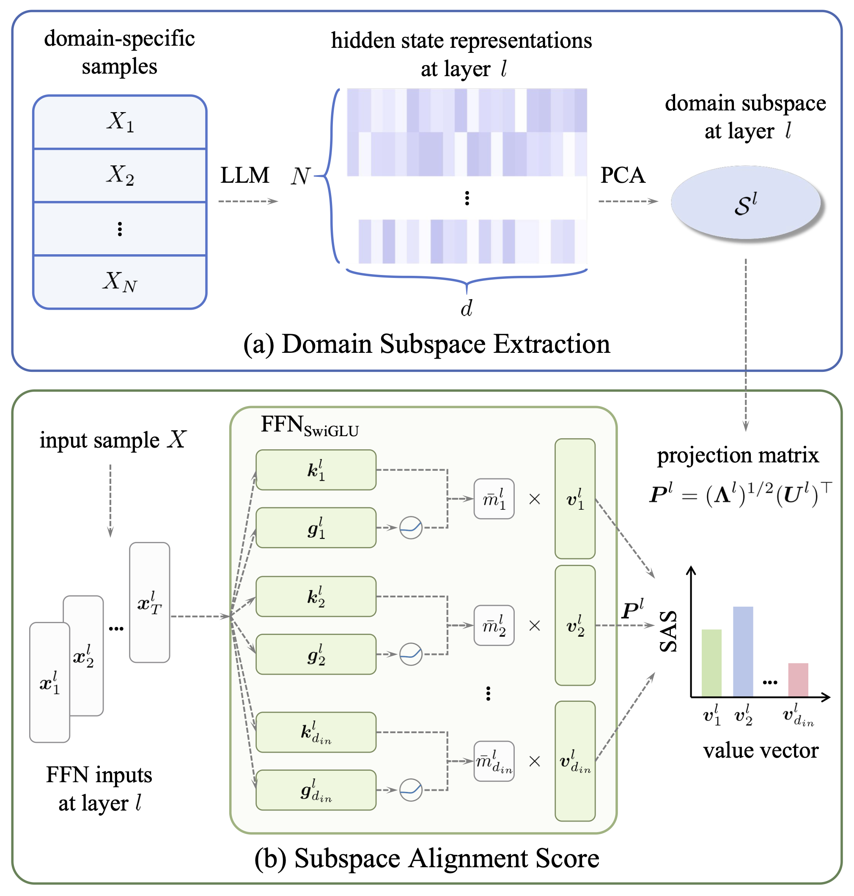

# Subspace Alignment Score: Locating Domain-Relevant Important Parameters in Large Language Models

## Introduction

This repository is for the EMNLP 2026 paper: [Subspace Alignment Score: Locating Domain-Relevant Important Parameters in Large Language Models](https://aclanthology.org/2026.emnlp-main.1504/).

- We analyze the geometric structure of the hidden state space in LLMs, revealing the distribution patterns and hierarchical evolution patterns of domain knowledge within hidden state space.
- We propose a novel parameter evaluation method that, compared to baseline methods, more accurately locates domain-relevant important parameters.
- We conduct structured fine-tuning on domain-relevant important parameters, which achieves better generalization ability while significantly reducing training costs.


## Overview

<p align="center">
    
</p>

- **(a) Domain Subspace Extraction**. We use PCA to extract the domain subspaces $`\mathcal{S}^l`$ spanned by the domain‑specific samples' hidden‑state representations.
- **(b) Subspace Alignment Score (SAS)**. SAS works at the layer level of LLMs, using the projection matrix $`\boldsymbol{P}^l`$ to project weighted value vectors $`\{\bar{m}^l_j\boldsymbol{v}^l_j \mid j=1, 2, \dots, d_{in}\}`$ into the domain subspace $`\mathcal{S}^l`$ to quantify their contributions to the main information flow.


## Core Implementation

Below is the core implementation of our method. *(We will sort out the full code along with usage instructions and release them shortly.)*

### Helper Functions
We use the following functions to obtain the activations and parameters required for computing SAS.

```python
def get_input_mean_hook(layer_i, input_list, mask):
    def hook(module, input, output):
        m = mask[0].to(input[0].device)  # shape: (batch_size, seq_len)
        valid_length = m.sum(dim=1)
        input_sum = (input[0].detach() * m.unsqueeze(-1)).sum(dim=1)
        input_mean = input_sum.float() / valid_length.unsqueeze(-1)
        input_list[layer_i].append(input_mean)
    return hook

def get_output_mean_hook(layer_i, output_list, mask):
    def hook(module, input, output):
        m = mask[0].to(output.device)  # shape: (batch_size, seq_len)
        valid_length = m.sum(dim=1)
        output_sum = (output.detach() * m.unsqueeze(-1)).sum(dim=1)
        output_mean = output_sum.float() / valid_length.unsqueeze(-1)
        output_list[layer_i].append(output_mean)
    return hook

def get_down_proj_matrix(model, layer_i):
    return model.model.layers[layer_i].mlp.down_proj.weight.detach()
```

### Domain Subspace Extraction

We use the `get_projection_matrix` function to compute the projection matrix, where `X` represents the residual stream activations of a specific layer in the model.

```python
def get_projection_matrix(X):
    n_samples, hidden_size = X.shape
    cov_matrix = (X.T @ X) / n_samples

    eigvals, eigvecs = torch.linalg.eigh(cov_matrix)
    eigvals, eigvecs = eigvals.flip(dims=[0]), eigvecs.flip(dims=[1])

    total_var = eigvals.sum()
    var_ratio = eigvals.cumsum(0) / total_var
    kneedle = KneeLocator(range(1, hidden_size + 1), var_ratio.cpu().numpy(), curve="concave", direction="increasing")
    num_components = kneedle.knee

    stds = torch.sqrt(eigvals[:num_components])
    principal_components = eigvecs[:, :num_components]

    return principal_components * stds
```

### Subspace Alignment Score

We use the following code to compute the SAS for a single sample. Before computing the SAS for a single sample, it is necessary to compute and store the projection matrices for each layer of the model.

```python
def get_projection_matrix_list(dataset, model, tokenizer, batch_size=32):
    layer_num = model.config.num_hidden_layers

    layer_output_list = [[] for _ in range(layer_num)]
    mask = [None]

    hooks = []
    for layer_i, layer in enumerate(model.model.layers):
        hooks.append(layer.register_forward_hook(
            get_output_mean_hook(layer_i, layer_output_list, mask)
            ))

    for i in tqdm(range(0, len(dataset), batch_size)):
        prompts = dataset[i : min(i + batch_size, len(dataset))]
        inputs = tokenizer(prompts, return_tensors="pt", padding=True, truncation=True, max_length=2048).to("cuda")
        mask[0] = inputs.attention_mask

        with torch.no_grad():
            model(**inputs)

    projection_matrix_list = []
    for layer_i in range(layer_num):
        layer_output = torch.cat(layer_output_list[layer_i], dim=0)
        projection_matrix = get_projection_matrix(layer_output)
        projection_matrix_list.append(projection_matrix)

    for hook in hooks:
        hook.remove()

    return projection_matrix_list

def get_sas_seq(prompt, model, tokenizer, projection_matrix_list):
    layer_num = model.config.num_hidden_layers

    coefficient_scores_list = [[] for _ in range(layer_num)]
    mask = [None]

    hooks = []
    for layer_i, layer in enumerate(model.model.layers):
        hooks.append(layer.mlp.down_proj.register_forward_hook(
            get_input_mean_hook(layer_i, coefficient_scores_list, mask)
            ))
        
    inputs = tokenizer(prompt, return_tensors="pt", truncation=True, max_length=2048).to("cuda")
    mask[0] = inputs.attention_mask

    with torch.no_grad():
        model(**inputs)

    scores_list = []
    for layer_i in range(layer_num):
        coefficient_scores = coefficient_scores_list[layer_i][0]
        value_vectors = get_down_proj_matrix(model, layer_i).float()
        projection_matrix = projection_matrix_list[layer_i]

        value_vectors_scaled = coefficient_scores * value_vectors
        value_vectors_projected = projection_matrix.T @ value_vectors_scaled
        sas = torch.norm(value_vectors_projected, dim=0)
        
        scores_list.append(sas.cpu().numpy())

    for hook in hooks:
        hook.remove()

    return scores_list
```

We use the following functions to efficiently compute the SAS for a domain dataset, requiring only a single forward pass.

```python
def get_layer_sas(layer_output, coefficient_mean, value_vectors):
    projection_matrix = get_projection_matrix(layer_output)

    value_vectors_scaled = coefficient_mean * value_vectors
    value_vectors_projected = projection_matrix.T @ value_vectors_scaled
    sas = torch.norm(value_vectors_projected, dim=0)

    return sas.cpu().numpy()

def get_sas_list(dataset, model, tokenizer, batch_size=32):
    layer_num = model.config.num_hidden_layers

    layer_output_list = [[] for _ in range(layer_num)]
    coefficient_scores_list = [[] for _ in range(layer_num)]
    mask = [None]

    hooks = []
    for layer_i, layer in enumerate(model.model.layers):
        hooks.append(layer.mlp.down_proj.register_forward_hook(
            get_input_mean_hook(layer_i, coefficient_scores_list, mask)
            ))
        hooks.append(layer.register_forward_hook(
            get_output_mean_hook(layer_i, layer_output_list, mask)
            ))

    for i in tqdm(range(0, len(dataset), batch_size)):
        prompts = dataset[i : min(i + batch_size, len(dataset))]
        inputs = tokenizer(prompts, return_tensors="pt", padding=True, truncation=True, max_length=2048).to("cuda")
        mask[0] = inputs.attention_mask

        with torch.no_grad():
            model(**inputs)

    scores_list = []
    for layer_i in range(layer_num):
        layer_output = torch.cat(layer_output_list[layer_i], dim=0)
        coefficient_scores = torch.cat(coefficient_scores_list[layer_i], dim=0)
        coefficient_mean = torch.mean(coefficient_scores.abs(), dim=0)
        value_vectors = get_down_proj_matrix(model, layer_i).float()
        sas = get_layer_sas(layer_output, coefficient_mean, value_vectors)
        scores_list.append(sas)

    for hook in hooks:
        hook.remove()

    return scores_list
```

### Important Parameter Fine-Tuning

We split the FFN layer along intermediate neuron channels, fine-tuning only the weights associated with important parameters while freezing the remainder, thereby conserving GPU memory. The specific implementation of the splitting operation is as follows.

```python
class SplitMLP(nn.Module):
    def __init__(self, orig_mlp, train_idx, freeze_idx):
        super().__init__()
        data_type = orig_mlp.gate_proj.weight.dtype

        self.act_fn = orig_mlp.act_fn
        self.hidden_size = orig_mlp.hidden_size
        self.intermediate_size = orig_mlp.intermediate_size
        self._orig_class = orig_mlp.__class__

        train_idx = torch.tensor(train_idx)
        freeze_idx = torch.tensor(freeze_idx)
        self.register_buffer("freeze_idx", freeze_idx)
        self.register_buffer("train_idx", train_idx)

        self.gate_proj_train = nn.Linear(self.hidden_size, len(train_idx), bias=False, dtype=data_type)
        self.up_proj_train   = nn.Linear(self.hidden_size, len(train_idx), bias=False, dtype=data_type)
        self.down_proj_train = nn.Linear(len(train_idx), self.hidden_size, bias=False, dtype=data_type)

        self.gate_proj_freeze = nn.Linear(self.hidden_size, len(freeze_idx), bias=False, dtype=data_type)
        self.up_proj_freeze   = nn.Linear(self.hidden_size, len(freeze_idx), bias=False, dtype=data_type)
        self.down_proj_freeze = nn.Linear(len(freeze_idx), self.hidden_size, bias=False, dtype=data_type)

        for p in self.gate_proj_freeze.parameters():
            p.requires_grad = False
        for p in self.up_proj_freeze.parameters():
            p.requires_grad = False
        for p in self.down_proj_freeze.parameters():
            p.requires_grad = False

        self._load_from_original(orig_mlp)

    def _load_from_original(self, orig):
        W_gate = orig.gate_proj.weight.detach()
        W_up = orig.up_proj.weight.detach()
        W_down = orig.down_proj.weight.detach()

        self.gate_proj_train.weight.data.copy_(W_gate[self.train_idx])
        self.gate_proj_freeze.weight.data.copy_(W_gate[self.freeze_idx])

        self.up_proj_train.weight.data.copy_(W_up[self.train_idx])
        self.up_proj_freeze.weight.data.copy_(W_up[self.freeze_idx])

        self.down_proj_train.weight.data.copy_(W_down[:, self.train_idx])
        self.down_proj_freeze.weight.data.copy_(W_down[:, self.freeze_idx])

    def forward(self, x):
        output_train = self.down_proj_train(self.act_fn(self.gate_proj_train(x)) * self.up_proj_train(x))
        output_freeze = self.down_proj_freeze(self.act_fn(self.gate_proj_freeze(x)) * self.up_proj_freeze(x))
        return output_train + output_freeze

def split_mlp(model, train_idx_list, freeze_idx_list):
    for i, layer in enumerate(model.model.layers):
        layer.mlp = SplitMLP(layer.mlp, train_idx_list[i], freeze_idx_list[i]).to("cuda")
```

After fine-tuning, we use the following code to merge the FFN layers back, restoring the original model structure.

```python
def merge_one_mlp(layer, split_mlp, config):
    orig_class = split_mlp._orig_class
    data_type = split_mlp.gate_proj_train.weight.dtype
    new_mlp = orig_class(config).to(data_type).to("cuda")

    train_idx = split_mlp.train_idx
    freeze_idx = split_mlp.freeze_idx

    with torch.no_grad():
        new_mlp.gate_proj.weight.index_copy_(0, train_idx, split_mlp.gate_proj_train.weight)
        new_mlp.gate_proj.weight.index_copy_(0, freeze_idx, split_mlp.gate_proj_freeze.weight)

        new_mlp.up_proj.weight.index_copy_(0, train_idx, split_mlp.up_proj_train.weight)
        new_mlp.up_proj.weight.index_copy_(0, freeze_idx, split_mlp.up_proj_freeze.weight)

        new_mlp.down_proj.weight.index_copy_(1, train_idx, split_mlp.down_proj_train.weight)
        new_mlp.down_proj.weight.index_copy_(1, freeze_idx, split_mlp.down_proj_freeze.weight)

    layer.mlp = new_mlp

def merge_mlp(model):
    for layer in model.model.layers:
        merge_one_mlp(layer, layer.mlp, model.config)
```

## Citation

```
@inproceedings{wu-etal-2026-subspace,
    title = "Subspace Alignment Score: Locating Domain-Relevant Important Parameters in Large Language Models",
    author = "Wu, Le  and
      Wu, Jiayi  and
      Xiong, Jixiang  and
      Mo, Mengfa  and
      Xin, Jingmin",
    booktitle = "Proceedings of the 2026 Conference on Empirical Methods in Natural Language Processing",
    year = "2026",
    pages = "34347--34366"
}
```
